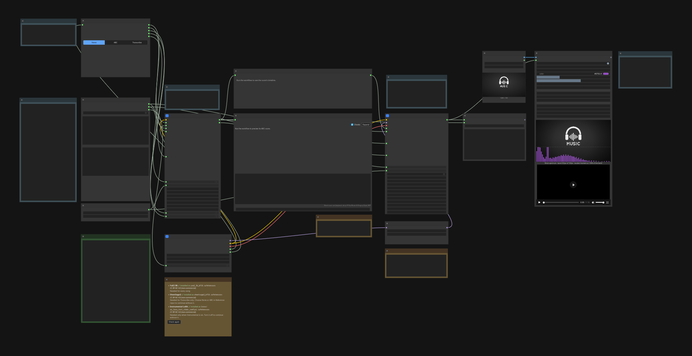

# ComfyUI-YuE2-Kit

_An intuitive workflow for YuE2 power users._

Turn lyrics and a style prompt into music, with an ABC score. The kit brings
reference input, score continuation, instrumental controls, and paired
FLAC + ABC export into one workflow. Its custom nodes also work in your own
workflows; some are still evolving.

## Install

Requires **ComfyUI 0.38.0+**. Install these packs through ComfyUI-Manager or
comfy-cli, then restart ComfyUI:

- [YuE2-Kit](https://registry.comfy.org/publishers/bno84/nodes/comfyui-yue2-kit)
  (`comfyui-yue2-kit`).
- [ABC Preview](https://registry.comfy.org/publishers/bno84/nodes/comfyui-abcpreview)
  0.3.0+ for notation, playback, and the score timeline.
- [Audio Visualizer](https://registry.comfy.org/publishers/bno84/nodes/comfyui-audiovisualizer)
  0.4.0+ for optional video export.

## Example workflow



Open **YuE2 Kit - Song workflow** in the template browser under **ComfyUI-YuE2-Kit**, or
load [the workflow JSON](<example_workflows/YuE2 Kit - Song workflow.json>).

## Basic usage

1. Set **Lyrics + style** and the **Seed**.
2. Choose a reference, or **None** for a fresh score.
3. Check **Model files**, then run.

Preview the score in the center of the workflow. **Final outputs** saves the
song as FLAC and its exact ABC score under matching, incrementing filenames.

**Acoustic** uses the score's estimated length plus a 10-second margin.
Enable **Maximum duration** there to set your own cap. This is an upper limit;
the song can end earlier.

## Optional features

**Instrumental LoRA:** enable **instrumental** above the lyrics input and use
**full** score mode. Follow the workflow's prompting cheat sheet: use
`[instrumental]` or lowercase section tags such as `[intro]`, `[verse]`, and
`[chorus]`, each on its own line. Timed tags are guidance, not exact timing.
The node warns about unsupported formats without rewriting your text.

**Reference input:** paste or drop ABC, or upload audio/video and click
**Transcribe now**. Choose Full or Melody to match your score mode.
With **Extend reference** off, the chosen score is used as-is and planning is
skipped. With it on, planning continues the reference as the start of the song.
Lyrics and style still apply.

**NAR LoRA:** an optional acoustic adapter that pairs well with Instrumental.
Start at strength **1.0**; select **(none)** or strength **0** to disable it.
Use the ComfyUI export linked in the workflow. No extra tokenizer is needed here.

**Preview playback:** the template tries `GeneralUser-GS.sf2`, including in
soundfont subfolders. Supply your own [GeneralUser GS](https://github.com/mrbumpy409/GeneralUser-GS)
or choose another General MIDI `.sf2` in `models/soundfonts/`. Missing fonts
leave notation available. Select **(none)** to disable playback.

**Visualizer video:** turn **enabled** on and choose an image in **Visualizer
still**, or use the supplied artwork. The image sets the video resolution.
For smaller files, use H.265/Opus, a smaller image, or 30 FPS. Video export
requires FFmpeg with `showcqt` and the selected codecs.

## API and tests

Use [the API prompt](api/yue2-kit-song.api.json).

```bash
node --test tests/*.mjs
python3 -m unittest discover -s tests
```
